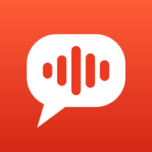

<p align="center"></p>

<h1 align="center">Say What</h1>
<p align="center">Wispr Flow–style voice dictation for <b>iPhone (app + keyboard)</b>, <b>Mac</b> and the <b>web</b>.<br>English 🇬🇧 + European Portuguese 🇵🇹. Runs Whisper on your device.</p>

---

## What it does

| | |
|---|---|
| 🎙️ **Talk, don't type** | Tap (iPhone) or hold a key (Mac), speak, and clean text appears where your cursor is. |
| 🇵🇹 **EN + PT-PT** | *Auto* picks English or Portuguese for each dictation, and only those two. It never drifts into Spanish. The Portuguese side is tuned for European spelling: *facto, receção, telemóvel, ecrã*. |
| 🔒 **On-device by default** | Whisper runs on the Neural Engine via [WhisperKit](https://github.com/argmaxinc/WhisperKit). Models: Tiny, Base, **Small (216 MB, default)** or Large-v3 Turbo. Works offline after the first download. |
| ✨ **Clean-up** | Removes fillers (*um, uh, hã, hum, tipo*) and stutters, adds punctuation and capitals, and handles voice commands (*new line / nova linha, ponto final, vírgula, apaga isso / scratch that*). |
| 🤖 **AI polish (optional)** | Apple's on-device model (iOS 26 / macOS 26 with Apple Intelligence) or Groq Llama. It applies self-corrections, formats lists and fixes PT-PT spelling. Guardrails stop it from ever "answering" your text. |
| 📖 **Dictionary** | Vocabulary hints, replacements (*chat gpt → ChatGPT*) and snippets (*my email → you@…*). |
| ⌨️ **iPhone keyboard** | Works inside any app. Same flow as Wispr: the first mic tap opens Say What, you swipe back, and from then on the mic is instant for the whole session (default 15 min). |
| 🖥️ **Mac menu-bar app** | Hold **Right ⌥** and talk, then release to paste into the frontmost app. A quick tap starts hands-free mode, and Esc cancels. |
| ⚡ **Groq Turbo (optional)** | Cloud `whisper-large-v3-turbo`: the fastest option and the most accurate for Portuguese. Paste your key in Settings. It's stored in the Keychain and never in this repo. |

## Install

### Web app (instant, any device)
Open **https://afonsopedroso.github.io/say-what/** in Safari, then tap **Share → Add to Home Screen**. It runs Whisper in the browser (WebGPU/WASM). It can't be a system keyboard: dictate, then paste.

### iPhone app + Say What keyboard

Apple requires every native app to be signed. A free Apple ID works; the app then needs re-installing every 7 days. A paid developer account ($99/yr) removes that limit.

**Option A: Xcode (recommended, 5 min, Mac)**
1. Install Xcode from the App Store, then clone the repo (or **Code → Download ZIP**) and open `SayWhat.xcodeproj`.
2. Click the **SayWhat** project → targets **SayWhat** and **SayWhatKeyboard** → *Signing & Capabilities* → set **Team** to your Apple ID (Personal Team).
3. Plug in your iPhone, pick it as the run destination, and press **▶ Run**.
4. On the iPhone, if asked: *Settings → Privacy & Security → Developer Mode* → On, then *General → VPN & Device Management* → trust your Apple ID.

**Option B: Sideloadly (Mac or Windows)**
1. Download **SayWhat.ipa** from [Releases → latest](https://github.com/afonsopedroso/say-what/releases/tag/latest).
2. Open [Sideloadly](https://sideloadly.io), plug in the iPhone, drop the IPA in and sign in with your Apple ID.

**Then turn on the keyboard:** *Settings → General → Keyboard → Keyboards → Add New Keyboard → Say What*. Tap it and enable **Allow Full Access**. Full Access is only used to talk to the Say What app; nothing you type is collected. In any app, hold 🌐 → **Say What** → tap the mic.

### Mac app
1. Download **SayWhat-Mac.zip** from [Releases → latest](https://github.com/afonsopedroso/say-what/releases/tag/latest), unzip, and drag **Say What** to Applications.
2. First launch: right-click → **Open**. If macOS still blocks it, run `xattr -dr com.apple.quarantine "/Applications/Say What.app"`.
3. Allow **Microphone** and **Accessibility** (needed to paste). Change the hotkey under Settings.

## How the iPhone keyboard works

iOS doesn't let keyboards use the microphone, so Say What does what Wispr Flow does:

```
Keyboard mic tap ──(no session)──▶ opens Say What (saywhat://dictate) → starts listening → you swipe back ◀
Keyboard mic tap ──(session live)─▶ Darwin notification → app records in background → transcribes → App Group → keyboard inserts
```

The app keeps the audio engine warm while a session is live, so the orange mic dot shows. It ends on its own after the time you choose in Settings.

## Project layout

```
Packages/SayWhatKit   shared settings, App Group bridge, EN/PT text cleaner (+ unit tests)
Shared/               recorder, WhisperKit + Groq transcribers, AI polish, dictation engine
iOS/App               SwiftUI app — Dictate, History, Dictionary, Settings, onboarding, keyboard session
iOS/Keyboard          the Say What keyboard extension
macOS/                menu-bar app, hold-to-talk hotkey, HUD, paste
web/                  PWA (transformers.js Whisper in a worker)
project.yml           XcodeGen spec (CI regenerates SayWhat.xcodeproj)
```

Every push to `main` builds on GitHub's macOS runners and updates the [latest release](https://github.com/afonsopedroso/say-what/releases/tag/latest).
